<div align="center">

# EDStudio

**A 3D animation studio run by Claude.**
Claude Code writes, builds, renders, checks and publishes faceless short-form videos, and every frame is code.

[](LICENSE)
[](https://threejs.org)
[](https://nodejs.org)
[](https://claude.com/claude-code)

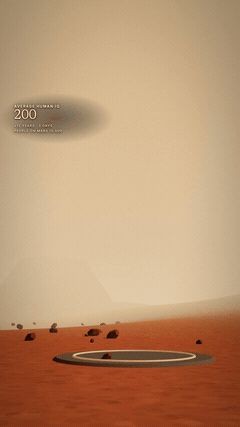
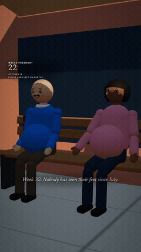
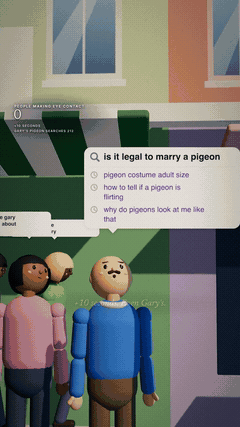
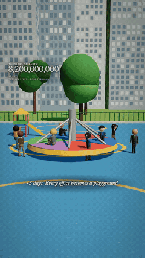
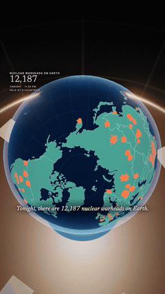
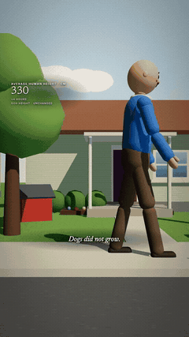
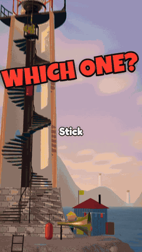
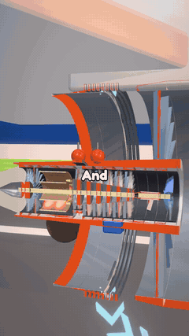

<sub>Frames from published videos: <i>twice as smart</i> (187K views) · <i>everyone pregnant</i> (141K) · <i>search history</i> (34K) ·
<i>toddlers</i> · <i>no nukes</i> · <i>height doubled</i> (13K). Views on TikTok as of Oct 26, 2026. Last two: build reels
<i>flashlight → lighthouse</i> · <i>hair dryer → jet engine</i>.</sub>

[Get started](GET-STARTED.md) · [Animation styles](#animation-styles) · [How a video is made](#how-a-video-is-made) · [Build reels](#build-reels) · [The operation](#run-a-channel-the-operation) · [License](#license)

</div>

## What it is

Each video is a Three.js (or Canvas 2D) scene that headless Chrome renders frame by frame, in one of nine animation styles
(below). Python synthesizes the music and sound effects, and ffmpeg encodes everything to 1080×1920. There's no stock footage
and no AI video, and nothing paid is required (narrated reels can use an ElevenLabs or Fish Audio voice; without a key they
fall back to the free macOS voice). Claude Code does the work:
- it writes the story and the 3D shots;
- it reviews still frames and fixes what looks wrong;
- it mixes the audio, renders and runs a QC checklist.

The repo also runs as a channel: a manager Claude assigns ideas to parallel producer sessions, scores each video with a
brain-response model, sends you a preview to approve on your phone, and schedules the post. The rule book Claude follows is
[`CLAUDE.md`](CLAUDE.md), written down one lesson at a time over 70 videos.

## What it can do

<table>
<tr>
<td width="50%" valign="top">

**Many formats, one engine**<br>
Funny "what if everyone on Earth…" sims, science what-ifs with sourced numbers, recurring-character series, emotional
stories, biographies, narrated build reels ("How a ___ Becomes a ___"), dupes of viral formats and product promo reels
([`docs/PROMO.md`](docs/PROMO.md)). Each format has its own pacing, HUD and sound identity ([`docs/TONES.md`](docs/TONES.md)).

</td>
<td width="50%" valign="top">

**A growing 3D world**<br>
52 sets (street, suburb, supermarket, classroom, plane, pool, Mars, war room, 1800s frontier…) plus the build-reel cutaways, a posable character rig
with crowds, kids, giants and toddlers, a prop library, and a hologram globe with Natural Earth borders.

</td>
</tr>
<tr>
<td valign="top">

**Sound without samples**<br>
[`audio/synth.py`](audio/synth.py) synthesizes piano, mallet, pluck, strings, drums, pads and a foley library from a cue
sheet. It then measures its own loudness and flags any mix where the music drops out.

</td>
<td valign="top">

**A brain-response gate**<br>
TRIBE v2 (Meta's model of the fMRI response to video) runs locally on a Mac. It scores every second and flags "dead zones",
so the video is fixed before it ships ([`tribe-experiment/`](tribe-experiment/results/report.md)).

</td>
</tr>
<tr>
<td valign="top">

**Stills first, render second**<br>
Claude renders a contact sheet of still frames, looks at it, and fixes framing, blocking and light before spending minutes
on a full render.

</td>
<td valign="top">

**A channel on autopilot, with you approving**<br>
Daily research, several videos building at once, a phone preview for your yes, and posts scheduled at fixed times
([`docs/OPERATION.md`](docs/OPERATION.md)).

</td>
</tr>
</table>

## Animation styles

One engine, nine looks. Every style is real, merged code with a starter template, and each one shipped at least one finished
reel. The full contract (what a new style has to deliver) and per-style notes are in [`docs/STYLES.md`](docs/STYLES.md).

<table>
<tr>
<td align="center" width="33%">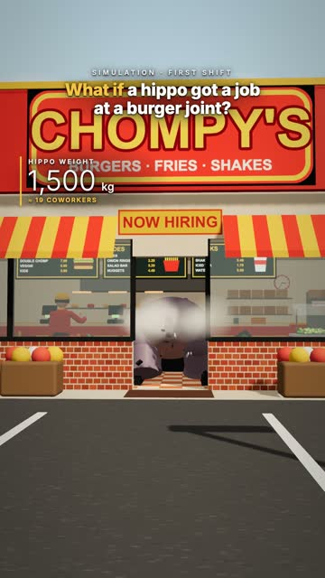<br><b>toy3d</b><br><sub>toy-like rig people, warm sets, many places<br><code>engine/rig.js</code> · <code>engine/sets/</code></sub></td>
<td align="center" width="33%">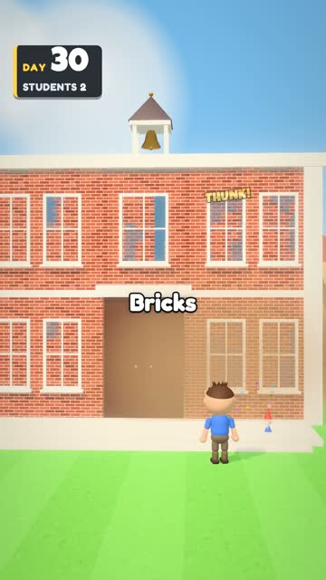<br><b>toon</b><br><sub>big-headed cast, 60 fps camera + kicks, one word on screen at a time<br><code>engine/build/</code> · <code>/new-build</code></sub></td>
<td align="center" width="33%">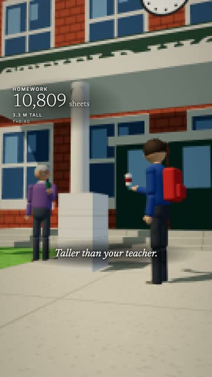<br><b>pixel</b><br><sub>any 3D scene in chunky n×n blocks + mosaic cuts<br><code>engine/pixel.js</code> · <code>_pixel-template</code></sub></td>
</tr>
<tr>
<td align="center">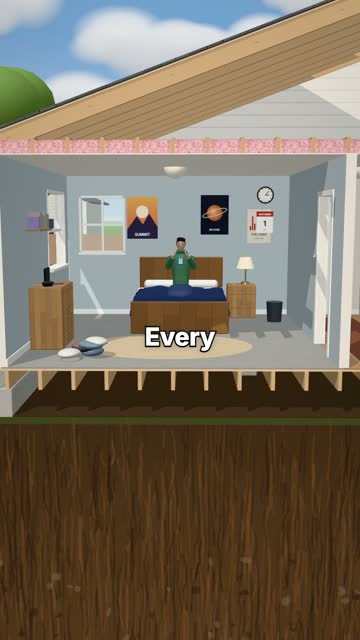<br><b>sim</b><br><sub>Sims-like realistic people, cut-away dollhouse sets<br><code>engine/sim/</code> · <code>_sim-template</code></sub></td>
<td align="center">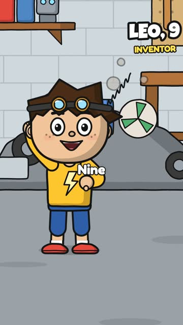<br><b>flat2d</b><br><sub>flat 2D cartoon (Canvas 2D), boiling ink outlines<br><code>engine/flat2d/</code> · <code>_flat2d-template</code></sub></td>
<td align="center">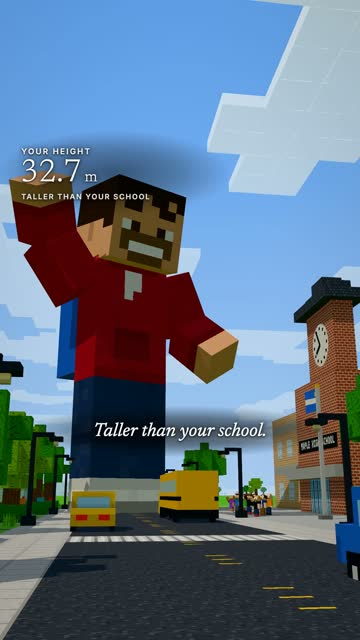<br><b>voxel</b><br><sub>a blocky-game world of 1 m cubes and pixel-art tiles<br><code>engine/voxel/</code> · <code>_voxel-template</code></sub></td>
</tr>
<tr>
<td align="center"><br><b>iso</b><br><sub>isometric tilt-shift dioramas floating over a gradient<br><code>engine/iso/</code> · <code>_iso-template</code></sub></td>
<td align="center">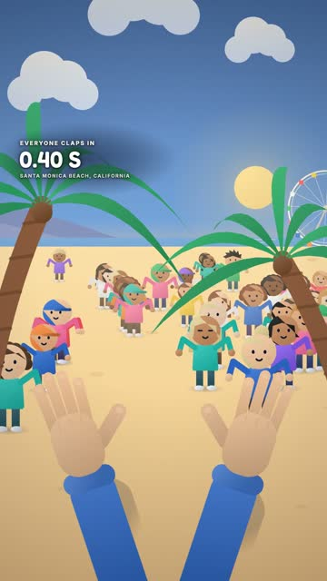<br><b>mg</b> (motion graphics)<br><sub>Kurzgesagt-like flat vector explainers, live charts and counters<br><code>engine/mg/</code> · <code>_mg-template</code></sub></td>
<td align="center"><br><b>anime</b><br><sub>a VRoid Studio character (VRM) on voxel sets, pixel captions<br><code>engine/vroid.js</code> · <code>engine/pixelcaps.js</code></sub></td>
</tr>
</table>

Start a reel in any style with `npm run new -- NNN-slug --from _<style>-template` (toon reels start from `/new-build`, anime
from an existing reel such as `--from 067-vex-deceive`). A Roblox-like blocky-avatar style is in production.

## How a video is made

```
/new-video what if everyone on Earth could hear each other's thoughts
```

1. **Concept and story:** Claude picks the tone, then writes `videos/NNN-slug/story.json`. It holds the opening question,
   the HUD counter, subtitles with timings, and the end card.
2. **3D shots:** `shots.js` builds the scene from `engine/sets/*`, `engine/rig.js` and `engine/props.js`. It defines the
   shot list, the camera moves and the per-frame poses.
3. **Stills review:** `node tools/render.mjs NNN-slug --stills …` and `tools/sheet.mjs` make a contact sheet. Claude opens
   it, fixes what's wrong and re-renders. This is the main loop.
4. **Audio:** `cues.json` goes into `audio/synth.py` and comes out as `audio.wav`, with a loudness and dropout self-check.
5. **Render and QC:** `node tools/render.mjs NNN-slug` produces `final.mp4`. Then it goes through the checklist at the
   bottom of `CLAUDE.md` (text safe zones, readable subtitles, no flicker, end card held ≥ 3.5 s) and a 1-frame-per-2-s
   scan like this one:

<p align="center">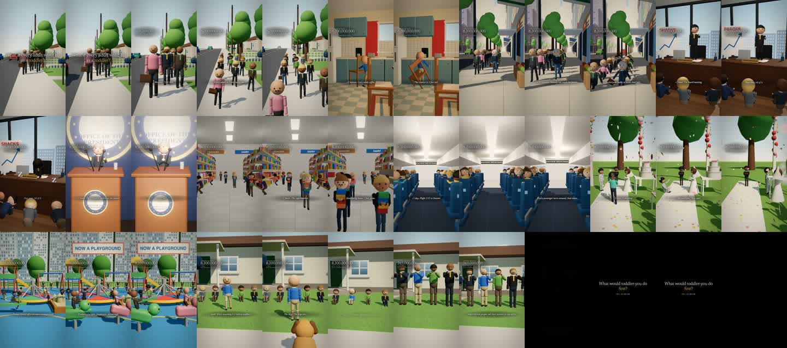</p>

6. **Brain score (optional, required in the operation):** `sh tools/tribe-score.sh videos/NNN-slug v1` scores the video
   against the best posted one. The weakest beats get a fix pass.
7. **Caption and commit:** `caption.md` must pass `tools/caption.py`, then the video folder is committed.

## Build reels

```
/new-build hair dryer → jet engine
```

"How a ___ Becomes a ___": a narrator roasts a humble object while it upgrades into a giant machine, one fix at a time, and
each fix gets its real engineering name. Gary the builder gets hurt by every failure. It has its own harness, written up in
[`docs/BUILD.md`](docs/BUILD.md):
- **The voice sets the clock.** `tools/narrate.py` voices `script.json` (ElevenLabs Adam on Eleven v3, or the macOS `say`
  voice when there's no key) and lays out `story.json` from the per-word timestamps.
- **One continuous camera, no cuts.** `engine/build/rail.js` plans a single gliding take through framings placed on the words
  they must show, with hard impact kicks on every landing. Renders run at 60 fps with motion blur.
- **One spoken word on screen at a time**, plus yellow callouts that name each term and counters that roll up the real
  numbers (`engine/build/captions.js`).
- **A cutaway set per reel** in `engine/build/` (subway, dam, car factory, space station, fire truck, tank, lighthouse, jet
  engine) and a big-headed cast in `toon.js`.
- **Measured pace.** `tools/pace.py`, `density.py`, `scenes.py` and `flow.py` check a cut against the reference reel:
  ≈ 5.8 syllables/s, a new place or look every ~2 s, and a camera under ~2.2 frame widths/s.
- **Five reviewers.** Each cut goes to five read-only Claude subagents (logic, look, pacing, camera, comedy) that score it
  out of 10. Claude applies their fixes and repeats until the scores reach the bar ([`docs/BUILD-REVIEW.md`](docs/BUILD-REVIEW.md)).

All eight build reels are in `videos/` with the script, shots, cue sheet, the voice takes they use and the final cut: 024
subway, 025 dam, 026 car factory, 032 space station, 033 fire truck, 034 tank, 039 lighthouse (the reference cut) and 041 jet
engine. For the real narrator, put `ELEVENLABS_API_KEY=…` in `~/.config/edstudio/.env` (outside the repo) or in a git-ignored
`.env` at the repo root.

## Architecture

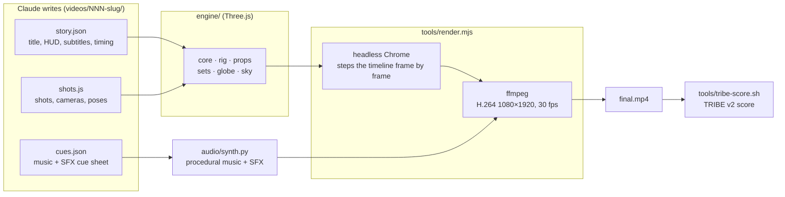

## Run a channel: the operation

```
/operation setup
```

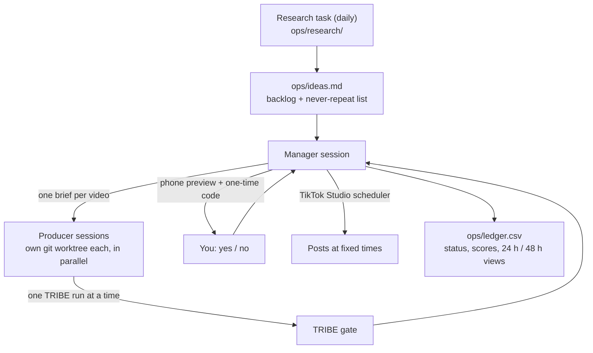

Each account gets its own content lane ([`docs/lanes/`](docs/lanes/README.md)). The state lives in files, so a new session
picks it up with `/operation resume`. Claude never types passwords, never solves CAPTCHAs, and never posts without your yes.

## Engineering notes

**Deterministic frames**
- *Problem:* the still you approve has to be the frame that ships, and several renders share one machine.
- *Approach:* `tools/render.mjs` doesn't play the scene in real time. It sets the timeline to t = i/30, screenshots each
  frame and pipes the JPEGs into ffmpeg. All randomness goes through a seeded `rng(seed)` (mulberry32 in `engine/core.js`),
  and `Math.random`/`Date` are banned in video code.
- *Why:* a busy machine can't drop or blur frames, and a still at 12.0 s is exactly frame 360 of the video.
- *Tradeoff:* rendering is slower than real time, about 3–6 minutes for a 70 s video.

**Sound with no samples, checked by the synth itself**
- *Problem:* no stock audio, a different sound identity per format, and a house rule that the music never cuts out.
- *Approach:* `audio/synth.py` builds every instrument and sound effect in numpy/scipy from a cue sheet. It then measures
  the mix: integrated loudness (BS.1770 plus ffmpeg `ebur128`), true peak, and a scan for any 50 ms window where the music
  stem falls more than 12 dB under its median.
- *Why:* the rules are enforced by a number in the log, not by someone listening.
- *Tradeoff:* synthesized instruments sound toy-like, which matches the visuals but not orchestral realism.

**A brain model on a laptop**
- *Problem:* TRIBE v2 expects CUDA. On a 24 GB Mac a single clip needed more than 20 GB and swapped.
- *Approach:* `tribe-experiment/mac_patches.py` computes attention in query chunks (max difference 0.0) and averages tokens
  per layer before stacking. V-JEPA 2 runs in half precision, with a feature correlation of 0.999997 against full
  precision. `tools/tribe-score.sh` holds a global lock so only one run happens at a time across all sessions.
- *Why:* scoring every video before it posts (~20 min each) makes "no dead zones" a production step.
- *Tradeoff:* it's a quality signal, not proven reach. On the main account it doesn't track views yet (rank correlation
  0.37, n = 6), so `ops/ledger.csv` keeps logging scores against 48 h views per account.

## Tech stack

| Layer | Used |
|---|---|
| 3D / 2D | three.js 0.170, plus our own rig, sets, props and globe (`engine/`); Canvas 2D for flat2d + mg; VRM characters via three's GLTFLoader (`engine/vroid.js`) |
| Rendering | puppeteer-core 23 driving installed Chrome (WebGL2); ffmpeg (bundled via `@ffmpeg-installer`) |
| Text overlay | HTML/CSS in the page, with the Inter and Newsreader fonts (`@fontsource`) |
| Audio | Python 3, numpy, scipy (`audio/synth.py`) |
| Narration | `tools/narrate.py`: ElevenLabs (Eleven v3) or Fish Audio (`--fish`, word-level timestamps), both optional; macOS `say` as the free scratch voice |
| Scoring | TRIBE v2 (PyTorch, V-JEPA 2, w2v-BERT), local, optional |
| Automation | Claude Code: `/new-video`, `/new-build`, `/new-biography`, `/operation`, parallel sessions, scheduled tasks, Claude in Chrome |

## Getting started

Needs **Node 18+**, **Google Chrome** and **Python 3 with numpy + scipy**. The full walkthrough, and a prompt that sets
everything up for you in Claude Code, is in [GET-STARTED.md](GET-STARTED.md).

```bash
git clone --depth 1 https://github.com/dylann4500/EDStudio.git
cd EDStudio
npm install
npm run doctor                                                       # every line should be ✅
node tools/render.mjs _template --stills 2,6,9 && node tools/sheet.mjs _template
```

Open `videos/_template/stills/_sheet.jpg`. A lit bedroom with a parent walking in means you're set.

<details>
<summary>Make a video by hand</summary>

```bash
npm run new -- 020-my-video                          # scaffold from the template
# edit videos/020-my-video/story.json + shots.js
node tools/render.mjs 020-my-video --stills 1,5,9   # still frames -> videos/020-my-video/stills/
node tools/sheet.mjs 020-my-video                    # one contact sheet of all stills
python3 -I audio/synth.py 020-my-video               # music + SFX from cues.json -> audio.wav
node tools/render.mjs 020-my-video                   # -> videos/020-my-video/final.mp4
```
Flags: `--preview` (fast draft), `--from 20 --to 28` (time range), `--cam top` (bird's-eye debug view).
</details>

## Repository layout

```
engine/            core (renderer, timeline helpers, text overlay), rig, props, sets/ (52 locations), globe, sky,
                   pixel.js (pixel pass), vroid.js + vrm.js (anime characters), pixelcaps.js
engine/build/      the build-reel kit: one-take camera rail, word captions, toon cast, effects, cutaway sets, Scribe app kit
engine/<style>/    sim/, flat2d/, voxel/, iso/, mg/: one folder per animation style (docs/STYLES.md)
videos/            one folder per video: story.json + shots.js + cues.json + caption.md + final.mp4;
                   _<style>-template/ folders are the starting point for each style
audio/             synth.py: procedural music + sound-effects library
tools/             render, stills sheet, new video, doctor, TRIBE lock, upload/preview copies, caption check
docs/              FORMAT.md + TONES.md (style), STYLES.md (the animation styles), BUILD.md + BUILD-REVIEW.md (build reels),
                   PROMO.md (promo reels), lanes/ (one brief per channel), OPERATION.md, reference/, media/
ops/               the operation's state: ledger, idea backlog, research digests
tribe-experiment/  local TRIBE v2 scoring, plus the study against real views
brand/             channel handles, bios and avatars
CLAUDE.md          the rule book for AI agents: style, engine cheat sheet, hard-won lessons
```

## Checking your setup

| Check | Command | Pass |
|---|---|---|
| Environment | `npm run doctor` | every line ✅ |
| Rendering | `node tools/render.mjs _template --stills 2,6,9` | 3 JPEGs in `videos/_template/stills/` |
| Caption format | `python3 -I tools/caption.py videos/014-toddler-world` | prints the caption, exit 0 |
| TRIBE lock | `sh tools/tribe-score.sh --status` | `free`, or the run that holds it |

## Status and limits

- **Narration is optional.** Build reels and promo reels are narrated; the what-if formats carry on-screen text, music and
  sound effects only. A real narrator needs an ElevenLabs or Fish Audio key; without one, `narrate.py` uses the macOS `say`
  voice (a scratch stand-in, macOS only).
- **One machine does all the work.** Renders and TRIBE runs are local, and TRIBE runs one at a time (20–60 min each), so
  output per day is bounded by that computer.
- **The brain score isn't proven to predict views** (see the third engineering note). It's logged so it can be tested.
- **Posting goes through TikTok Studio's web scheduler in your browser**, because there's no API. A CAPTCHA or a sign-in
  needs you.

## License

[PolyForm Noncommercial 1.0.0](LICENSE). Free for personal, non-commercial use, with credit kept on every copy. Commercial
use needs written permission: running monetized channels with it, selling or repackaging it, or selling a course or
service built on it. To ask, open an issue. The rendered videos, the GIFs in `docs/media/` and the brand assets are all
rights reserved. Third-party components keep their own licenses, and TRIBE v2 is CC BY-NC 4.0.
