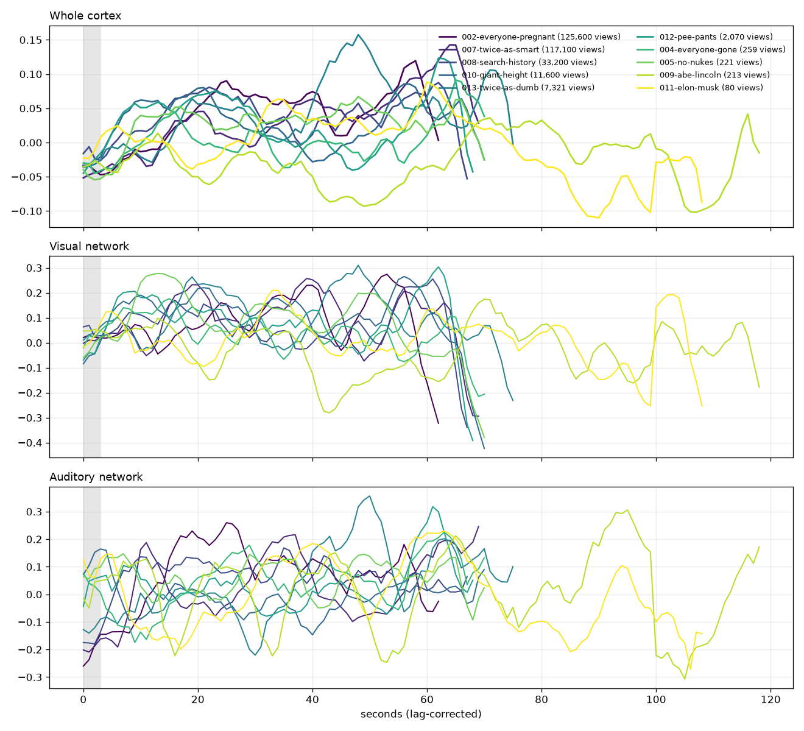
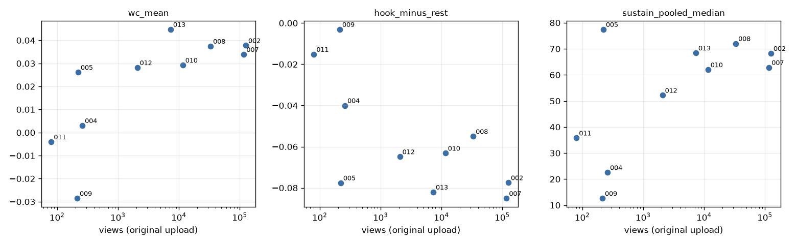
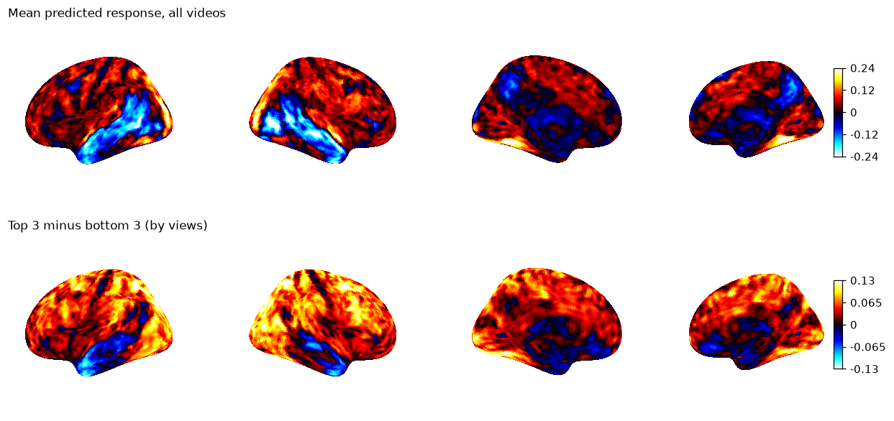

# TRIBE v2 brain-response experiment: EDStudio TikToks

**Question.** Do the videos that performed best on TikTok also get a stronger, more sustained *predicted* brain response from
Meta's TRIBE v2 model? If so, could a TRIBE score gate what gets published?

**Short answer.** Across all 10 original uploads, the brain score ranks the videos much like their views
(**rank correlation 0.84**). But that comparison mixes three accounts that took off very differently. On the one account
where the comparison is fair (@ed._.studios, 6 videos), **views follow posting order almost perfectly (−0.94)**, and the
brain score doesn't follow posting order. The newest test case cuts against the idea: "Twice as dumb" has the
**highest brain score of all 10** but sits 5th of 6 on its account (7.3K views). **Treat this as a lead worth testing
properly, not as a publish/don't-publish gate.**

*Updated Oct 24 with posting times and current view counts from the public profiles, plus a 10th video (013, twice as dumb).
The first version of this report used the earlier view snapshot and treated re-uploads as an "account effect"; see §3.*

---

## 1. What was run

| | |
|---|---|
| Model | TRIBE v2 (`facebook/tribev2`, CC BY-NC 4.0, used for a personal non-commercial experiment). Predicts an *average person's* fMRI response on the fsaverage5 cortex (20,484 surface points), one value per second, already shifted 5 s for blood-flow lag |
| Machine | MacBook, Apple M5 Pro, 24 GB. Everything ran locally; no video left the machine |
| Videos | the 10 `final.mp4` files in this repo that are posted on TikTok (`videos/NNN-*/final.mp4`). *If a published TikTok was an earlier cut than the committed file, its brain score is for the committed version* |
| Views | read from the three public profiles on Oct 24, one row per **original upload** (`../perf.csv`). Posting times come from the TikTok video IDs, which encode the upload second |
| Encoders actually used | **video**: V-JEPA 2 giant (64-frame clips, 2 per second); **audio**: w2v-BERT 2.0; **text**: none (see below) |
| Run time | ~3.5 h of encoding for all 10 (≈7 s per 64-frame clip), after the setup work below |

**Three things differ from a stock GPU run. None of them change what the model computes:**

1. **No speech → no text stream.** EDStudio videos have no spoken words: the audio is synthesized music and sound effects,
   and even the biography "narration" is on-screen text. TRIBE's language input (Llama 3.2) only listens to *speech*, so it
   received nothing, exactly as for any wordless video. The video encoder sees the subtitles as pixels but was not trained to
   read them. (Nice side effect: the gated Llama download and the HuggingFace account weren't needed.)
2. **Mac GPU instead of CUDA**, via small patches in `../mac_patches.py` (TRIBE's own code is untouched):
   attention computed in query chunks (verified identical: max difference 0.0) and token-averaging each layer before
   stacking (identical by construction). Without these, one clip needed >20 GB and pushed the Mac into swap.
3. **V-JEPA 2 in half precision.** On a test clip its features matched full precision with correlation **0.999997** on every
   layer (max error 0.09%), at half the memory and about 2× the speed.

**Metrics** (all per-second means, so 63 s and 119 s videos are comparable):
- *Whole-brain mean*: the average predicted response over all 20,484 points and all seconds. *First 60 s*: same, over
  the first 60 s only (every video has them; the biographies run 109–119 s).
- *% above threshold*: share of point-seconds above **0.162**, the 90th percentile of all predictions pooled across all 10
  videos (one fixed number for every video).
- *Opening (hook)*: mean over seconds 0–3 (the title card); *opening minus rest*: that minus the mean of the rest.
- *Sustain*: % of seconds where the whole-brain mean is above **0.019**, the median second across all videos (a fixed bar).
  The suggested "% above the video's *own* median" is ≈50% for every video by definition (last column of table 2), so it
  can't tell videos apart.
- *Networks*: areas of the HCP-MMP1 atlas (Glasser 2016), selected the same way as TRIBE's own ROI helper. **Visual** =
  V1–V8, LO, ventral visual (2,149 points); **motion** = MT+ complex (MT, MST, FST, V4t; 168); **auditory** = A1 + belt +
  A4/A5 (590); **language** = left 44/45/47l/55b/IFJa/SFL/PSL/STS/TPOJ1/STGa (602); **default-mode** = posterior
  cingulate/precuneus/medial prefrontal/angular (1,679).

## 2. Results

Sorted by views of the original upload.

| # | Video | Account | Posted (PT) | Views | Length | Whole-brain mean | First 60 s | % above threshold | Opening 0–3 s | Opening minus rest | Sustain* |
|---|---|---|---|---|---|---|---|---|---|---|---|
| 002 | Everyone woke up pregnant | @ed._.studios | Oct 22 6:00 PM | 125,600 | 63 s | +0.038 | +0.038 | 14.5% | -0.036 | -0.077 | 68% |
| 007 | Every human became twice as smart | @ed._.studios | Oct 22 6:55 PM | 117,100 | 70 s | +0.034 | +0.022 | 14.5% | -0.048 | -0.085 | 63% |
| 008 | Search history floated above their head | @ed._.studios | Oct 23 12:53 AM | 33,200 | 68 s | +0.037 | +0.037 | 10.6% | -0.015 | -0.055 | 72% |
| 010 | Height doubled overnight | @ed._.studios | Oct 23 11:01 AM | 11,600 | 71 s | +0.029 | +0.029 | 13.7% | -0.031 | -0.063 | 62% |
| 013 | Every human became twice as dumb | @ed._.studios | Oct 23 2:28 PM | 7,321 | 76 s | +0.045 | +0.042 | 15.7% | -0.034 | -0.082 | 68% |
| 012 | Everyone peed their pants | @ed._.studios | Oct 23 12:16 PM | 2,070 | 69 s | +0.028 | +0.022 | 11.8% | -0.034 | -0.065 | 52% |
| 004 | Every human disappeared except you | @ed_.studios | Oct 23 9:14 AM | 259 | 71 s | +0.003 | -0.007 | 7.6% | -0.035 | -0.040 | 23% |
| 005 | Every nuclear weapon vanished | @ed_.studios | Oct 23 1:03 AM | 221 | 71 s | +0.026 | +0.026 | 10.6% | -0.048 | -0.078 | 77% |
| 009 | Abraham Lincoln biography | @ed._.sims | Oct 23 9:41 AM | 213 | 119 s | -0.029 | -0.044 | 3.8% | -0.032 | -0.003 | 13% |
| 011 | Elon Musk biography | @ed._.sims | Oct 23 10:44 AM | 80 | 109 s | -0.004 | +0.014 | 4.4% | -0.019 | -0.015 | 36% |

\*Sustain = % of seconds above the fixed pooled median (0.019).

| # | Visual mean / peak | Motion (MT+) mean / peak | Auditory mean / peak | Language mean / peak | Default-mode mean / peak | Sustain vs own median |
|---|---|---|---|---|---|---|
| 002 | +0.082 / +0.274 | -0.077 / +0.151 | +0.062 / +0.260 | -0.055 / +0.115 | -0.024 / +0.039 | 49% |
| 007 | +0.083 / +0.257 | -0.092 / +0.336 | +0.027 / +0.245 | -0.069 / +0.064 | -0.024 / +0.066 | 50% |
| 008 | +0.068 / +0.255 | -0.113 / +0.220 | +0.059 / +0.168 | -0.027 / +0.106 | +0.005 / +0.091 | 50% |
| 010 | +0.097 / +0.265 | -0.013 / +0.382 | -0.007 / +0.164 | -0.093 / +0.039 | -0.029 / +0.040 | 49% |
| 013 | +0.093 / +0.310 | -0.029 / +0.523 | +0.041 / +0.357 | -0.046 / +0.148 | -0.011 / +0.095 | 50% |
| 012 | +0.082 / +0.304 | -0.092 / +0.324 | +0.034 / +0.318 | -0.077 / +0.044 | -0.023 / +0.040 | 49% |
| 004 | +0.032 / +0.176 | -0.253 / +0.343 | +0.044 / +0.225 | -0.074 / +0.072 | -0.050 / +0.021 | 49% |
| 005 | +0.071 / +0.278 | -0.200 / +0.072 | +0.062 / +0.147 | -0.047 / +0.006 | -0.025 / +0.044 | 49% |
| 009 | -0.030 / +0.174 | -0.197 / +0.352 | +0.011 / +0.306 | -0.063 / +0.192 | -0.052 / +0.064 | 50% |
| 011 | +0.012 / +0.210 | -0.118 / +0.234 | -0.003 / +0.230 | -0.043 / +0.132 | -0.031 / +0.094 | 50% |

### Top 3 vs bottom 3

Top 3 = 002, 007, 008 (all @ed._.studios). Bottom 3 = 005 (@ed_.studios), 009 and 011 (@ed._.sims).

| Metric | Top 3 | Bottom 3 | Exact permutation p |
|---|---|---|---|
| Whole-brain mean | +0.036 | −0.002 | 0.10 (the smallest p a 3-vs-3 test can give) |
| First 60 s | +0.032 | −0.001 | 0.20 |
| % above threshold | 13.2% | 6.3% | 0.20 |
| Opening minus rest (hook) | −0.073 | −0.032 | 0.30 |
| Sustain (fixed bar) | 68% | 42% | 0.40 |

The top 3 are higher on whole-brain mean (every top video beats every bottom video). **Hook strength and sustain
don't separate the groups.** With 3 vs 3 videos, no result can reach p < 0.05.

### Correlation with views (Spearman rank, log views)

| Metric | All 10 original uploads | @ed._.studios only (n = 6) |
|---|---|---|
| Whole-brain mean | **0.84** (p = 0.002) | 0.37 (p = 0.47) |
| First 60 s (length-matched) | 0.69 (p = 0.03) | 0.26 (p = 0.62) |
| % above threshold | 0.73 (p = 0.02) | 0.14 (p = 0.79) |
| Opening minus rest | −0.59 (p = 0.07) | −0.20 (p = 0.70) |
| Sustain (fixed bar) | 0.48 (p = 0.16) | 0.37 (p = 0.47) |
| Visual network mean | 0.62 (p = 0.05) | −0.37 |
| Default-mode mean | 0.62 (p = 0.05) | −0.26 |

Full numbers for all 18 metrics are in `stats.json`.

## 3. Posting order: what the public profiles show

All 14 uploads went up within ~21 hours (Oct 22 6:00 PM → Oct 23 2:50 PM PT):

| Posted (PT) | Account | Video | Views | Brain score |
|---|---|---|---|---|
| Oct 22 6:00 PM | @ed._.studios | Everyone pregnant | 125.6K | +0.038 |
| 6:55 PM | @ed._.studios | Twice as smart | 117.1K | +0.034 |
| Oct 23 12:53 AM | @ed._.studios | Search history | 33.2K | +0.037 |
| 1:03 AM | @ed_.studios | No nukes | 221 | +0.026 |
| 9:14 AM | @ed_.studios | Everyone gone | 259 | +0.003 |
| 9:41 AM | @ed._.sims | Lincoln | 213 | −0.029 |
| 10:44 AM | @ed._.sims | Musk | 80 | −0.004 |
| 11:01 AM | @ed._.studios | Height doubled | 11.6K | +0.029 |
| 12:16 PM | @ed._.studios | Peed pants | 2,070 | +0.028 |
| 12:21 PM | @ed_.studios | Peed pants (re-upload) | 318 | same video |
| 12:23 PM | @ed._.sims | Peed pants (re-upload) | 73 | same video |
| 2:28 PM | @ed._.studios | Twice as dumb | 7,321 | **+0.045** |
| 2:34 PM | @ed_.studios | Twice as smart (re-upload) | 205 | same video |
| 2:50 PM | @ed._.sims | Twice as smart (re-upload) | 8 | same video |

What this shows:

1. **Re-uploads always rank in upload order.** Peed pants: 2,070 → 318 → 73. Twice as smart: 117.1K → 205 → 8. TikTok
   holds back copies of a video it has already seen, so these are a duplicate penalty, not a test of the account. This
   replaces the earlier "82× account effect" reading, and supports the view that @ed._.studios grew because its videos
   were good: it got its first two posts out first and both took off immediately.
2. **On @ed._.studios, views fall almost perfectly with posting order** (rank correlation −0.94): each later post got
   fewer views, except "twice as dumb", which beat "peed pants" despite going up 2 h later. The brain score doesn't
   follow posting order at all (−0.09). Earlier posts had more hours online and caught the account's first wave, and that
   explains most of the main-account spread without any brain score.
3. **The one out-of-order result agrees with the brain score**: twice as dumb (+0.045) beat peed pants (+0.028). With
   posting order partialled out, brain score vs views comes out at 0.88, but on 6 videos that number rests on this single
   swap, so it's not evidence on its own.
4. **The first post on each account lines up with the brain score:** pregnant (+0.038 → 125.6K) vs no nukes (+0.026 → 221)
   vs Lincoln (−0.029 → 213). But that's 3 data points, and a 0.012 score gap separating 125.6K from 221 views is a lot to
   pin on the video alone.

## 4. Why not to trust the headline number yet

1. **Posting order and account momentum.** Most of the spread in views is "posted first on the account that took off".
   Inside that account, the brain score doesn't predict the order (0.37, n = 6). Its highest-scoring video (twice as dumb)
   is 5th of 6.
2. **Video type is tied to account.** Funny what-ifs went on @ed._.studios, world what-ifs on @ed_.studios, and the
   biographies on @ed._.sims. The model scores bright, busy, funny what-ifs higher than dark or long ones (whole-brain mean
   vs brightness 0.62, vs motion 0.54). So "high score" partly means "this is a funny what-if", which is also what took off.
3. **Length.** The two biographies are 109–119 s and everything else is 63–76 s. Their second minutes sag (Musk 70–108 s;
   Lincoln at the general-store / law-books / debates stretch, ~40–55 s, and the assassination, ~100–105 s). On the
   first 60 s only, the all-video correlation drops from 0.84 to 0.69.
4. **The score is noisy within a video.** Rank the videos on the first half of each timecourse and again on the second
   half: the two rankings agree only weakly (split-half rank correlation 0.26). A different edit of the same idea could
   score quite differently.
5. **Partly it's tracking sound.** Second by second, the whole-brain response follows loudness (median within-video
   correlation 0.21) more than brightness (0.01) or motion (0.08). Across videos, a wide quiet-to-loud range (the
   sound-design-led mixes of 004, 005, 009) goes with a lower score (−0.67) *and* fewer views (−0.50).
6. **Chance.** 18 metrics × 3 comparisons ≈ 54 tests. A couple of p < 0.05 results are expected by luck alone.
7. **Not what the model was built for.** TRIBE predicts an *average brain's* fMRI response. Nobody has shown that more
   predicted activation means more watch time, rewatches or shares.

## 5. What it *does* suggest

- **Every video's weakest stretch is its opening.** The whole-brain response is negative during the 0–3 s title card in all
  10 videos and climbs over the first ~10 s. The winners don't have stronger openings; they have stronger *middles*. This
  is a model prediction, not a measured drop-off. TikTok's retention graph for the first 3 seconds is the way to check
  whether the quiet, text-only open actually costs viewers.
- **Dips line up with the house rules you already have.** The lowest stretches are the empty, dark world of 004, the dim
  indoor scenes in the middle of Lincoln, and Musk's long tail. That's the same "keep beats short and busy, no static
  holds" feedback already in CLAUDE.md. A TRIBE pass could serve as an automated **dead-zone detector**, flagging any
  stretch of ≥ 8 s below the pooled median, without trusting it as a gate.

## 6. How to actually test the gate idea

1. **Use retention curves, not views.** TikTok Studio shows per-second audience retention for each post. Correlating the
   per-second TRIBE response with per-second retention *within each video* removes posting order, account and length
   entirely (each video is its own control) and gives ~60–110 data points per video instead of 1.
2. **Score before posting, compare inside one account.** Post the next 10+ videos on @ed._.studios, spaced evenly (e.g.
   one per day, same time), score each one *before* it goes up, and compare views at a fixed age (e.g. 48 h). Pre-register
   the metric (e.g. *first 60 s whole-brain mean*) so you're not picking the best of 18 after the fact.
3. **Don't re-upload the same file to other accounts.** The copies always get suppressed, so they waste a post and muddy
   the data.
4. **Add a voice track test.** These reels give TRIBE's language pathway nothing. A narrated vs subtitle-only version of
   the same video would show whether speech changes the predicted response (and, posted on one account, the views).

## 7. Files

| File | What |
|---|---|
| `results/<slug>.npy` | raw predictions, shape (seconds, 20484), float32 (not committed; regenerate with `run_tribe.py`) |
| `results/summary.csv` | every metric per video + views, account, posting time |
| `results/stats.json` | all correlations, permutation tests, posting-order, confound and reliability checks |
| `results/lowlevel.csv` | motion, cuts, brightness, loudness per video |
| `results/timecourses.png`, `scatter.png`, `brain_maps.png` | figures above |
| `perf.csv` | every upload (incl. re-uploads) with account, posting time, current views and the earlier snapshot |
| `run_tribe.py`, `mac_patches.py`, `analyze.py`, `low_level.py` | the pipeline (rerun: `.venv/bin/python run_tribe.py videos/*.mp4 && .venv/bin/python low_level.py && .venv/bin/python analyze.py`) |
